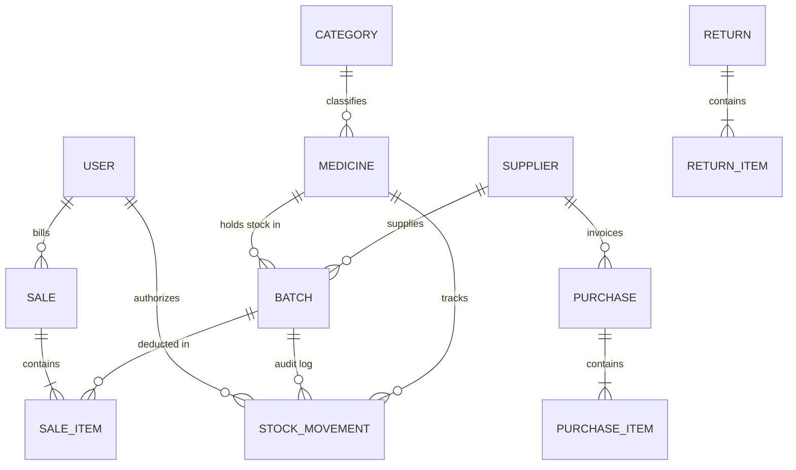

# PharmaCore ERP — Pharmacy Management System
### Full-Stack Web Development | Advanced Individual Project Assessment
**Assessment for:** ALGIONS AI LABS PRIVATE LIMITED  
**Assigned Project:** Pharmacy Management System  

---

## 📌 Project Overview
**PharmaCore ERP** is a responsive, database-backed business application engineered for modern retail and hospital pharmacy operations. Unlike generic retail software, PharmaCore enforces pharmaceutical-specific safety and audit standards:
- **Granular Batch Inventory**: Tracks stock at the individual batch level (`batchNumber`, `mfgDate`, `expiryDate`, `purchasePrice`, `sellingPrice`, `quantity`) rather than treating stock as an aggregate total.
- **FEFO (First-Expiry-First-Out) Dispensing**: Automatically allocates stock from the earliest-expiring active batch to prevent inventory expiration.
- **Zero Expired Sales Policy**: Strictly prevents dispensing of batches where `expiryDate <= today` at both the query level and transactional constraint level.
- **Mandatory Reason on Returns & Adjustments**: Requires detailed clinical/operational reasons for customer returns, breakage disposals, and physical cycle count adjustments.
- **Audit Movement Ledger & Complete Stock Reconciliation**: Maintains an immutable double-entry ledger where `Opening Stock + Purchases - Sales + Returns ± Adjustments = Closing Stock` with zero discrepancy.
- **Server-Side Role-Based Authorization (RBAC)**: Gated roles for **Admin**, **Pharmacist**, and **Cashier**.

---

## 🏗️ Architecture & Technology Stack

| Layer | Technology | Rationale |
|:---|:---|:---|
| **Frontend** | React 18, Vite, TypeScript, Tailwind CSS, Lucide Icons | Fast compile time, type safety, clinical high-density UI without generic AI bloat. |
| **Backend API** | Node.js, Express, TypeScript, Zod | Clean modular monolith with strict schema validation and predictable REST endpoints. |
| **Persistence / ORM** | SQLite, Prisma ORM | Zero-setup, ACID-compliant relational transactions with automatic migrations and deterministic seeding. |
| **Testing** | Jest, Supertest | Automated test coverage for all 5 assessment acceptance criteria and RBAC security rules. |
| **API Documentation** | OpenAPI 3.0 / Swagger UI | Interactive API explorer mounted at `/api-docs`. |

---

## 🔑 Demo Staff Credentials

The database is pre-seeded with test accounts for each role:

| Role | Email Address | Password | Permissions |
|:---|:---|:---|:---|
| **Admin** | `admin@pharmacy.com` | `Password@123` | Full system access: User management, catalogue, reports, audit trail. |
| **Pharmacist** | `pharmacist@pharmacy.com` | `Password@123` | Inventory control, batch creation, stock-in purchases, adjustments, returns, reports. |
| **Cashier** | `cashier@pharmacy.com` | `Password@123` | Point-of-Sale (POS) dispensing, invoice generation, customer billing. |

*(Note: The login screen includes a 1-click demo role switcher to test each user role without manual typing).*

---

## 🚀 Quickstart & Setup Guide

### Prerequisites
- **Node.js** v18+ (tested on Node v20/v22/v25)
- **npm** v9+

### 1. Clone & Install Dependencies
From the repository root:
```bash
# Install root and all workspace dependencies (frontend & backend)
npm install
```

### 2. Configure Environment Variables
Copy the example environment file for the backend:
```bash
cp backend/.env.example backend/.env
```
*(Default settings use port `5001` and local SQLite database `backend/prisma/pharmacy.db`)*.

### 3. Initialize Database & Seed Demo Data
```bash
# Push Prisma schema and populate seed data
cd backend
npx prisma generate
npx prisma db push
npx tsx prisma/seed.ts
cd ..
```

### 4. Run the Development Servers
From the root directory, run both frontend and backend concurrently:
```bash
npm run dev
```

- **Frontend Application**: [http://localhost:5173](http://localhost:5173)
- **Backend API**: [http://localhost:5001](http://localhost:5001)
- **Interactive Swagger Docs**: [http://localhost:5001/api-docs](http://localhost:5001/api-docs)
- **Health Check**: [http://localhost:5001/health](http://localhost:5001/health)

---

## 🧪 Automated Testing

Run the automated test suite verifying all required acceptance criteria:

```bash
cd backend
npm test
```

### Verified Acceptance Tests:
1. **Acceptance Test 1**: A sale deducts quantity from the earliest-expiring active batch (FEFO) and logs an auditable stock movement.
2. **Acceptance Test 2**: An expired batch (`expiryDate <= today`) is strictly blocked from sale with an HTTP 400 Bad Request.
3. **Acceptance Test 3**: System identifies near-expiry batches (≤60 days) and low-stock medicines below reorder thresholds.
4. **Acceptance Test 4**: Stock adjustments/returns require a mandatory reason, record audit movements, and prevent negative stock.
5. **Acceptance Test 5**: Stock reconciliation report verifies that calculated closing stock equals physical batch stock (discrepancy = 0).
6. **RBAC Security**: Unauthorized roles (Cashier) are forbidden from adjusting stock or viewing internal audit records.

---

## 📊 Database Schema & ER Diagram



For complete table definitions, constraints, and relational mappings, see [docs/ERD_DIAGRAM.md](file:///Users/ayushkumar/Desktop/Aligions/docs/ERD_DIAGRAM.md).

---

## 📁 Repository Structure

```
Aligions/
├── package.json             # Root workspace script runner
├── backend/
│   ├── prisma/
│   │   ├── schema.prisma    # Relational SQLite schema with indexes & constraints
│   │   └── seed.ts          # Deterministic seed data (Users, Medicines, Batches, Movements)
│   ├── src/
│   │   ├── controllers/     # Express HTTP handlers (Auth, Medicine, Sale, Batch, Return, Report)
│   │   ├── middlewares/     # Auth JWT, RBAC authorization, and error handling
│   │   ├── routes/          # REST route declarations
│   │   ├── services/        # Core domain services: FefoService, SaleService, InventoryService
│   │   ├── utils/           # OpenAPI / Swagger specification
│   │   ├── app.ts           # Express app configuration
│   │   └── server.ts        # Server entrypoint
│   └── tests/
│       └── acceptance.test.ts # Supertest/Jest acceptance test suite
├── frontend/
│   ├── src/
│   │   ├── api/             # Axios client with JWT interceptor
│   │   ├── components/      # UI components (Printable Invoice Modal, Layout, Alerts)
│   │   ├── context/         # AuthContext with role switcher
│   │   ├── pages/           # Dashboard, POS Billing, Inventory, Sales, Purchases, Adjustments, Reports
│   │   └── types/           # TypeScript interfaces
│   └── vite.config.ts
└── docs/
    ├── ARCHITECTURE.md      # Detailed system architecture & transaction isolation
    ├── ERD_DIAGRAM.md       # Complete database ER diagram & mathematical reconciliation
    ├── TECHNICAL_REPORT.md  # Detailed technical report on design decisions
    └── DEMO_WALKTHROUGH_SCRIPT.md # 3–5 min video walkthrough script for presentation
```

---

## 📝 Submission Form Fields (Reference)

| Form Section | Submitted Detail |
|:---|:---|
| **Internship Role** | Full-Stack Web Development |
| **Assigned Project** | Pharmacy Management System |
| **Tech Stack** | React 18, Vite, TypeScript, Tailwind CSS, Node.js, Express, Prisma ORM, SQLite, Jest |
| **Demo Accounts** | `admin@pharmacy.com` / `Password@123`<br>`pharmacist@pharmacy.com` / `Password@123`<br>`cashier@pharmacy.com` / `Password@123` |
| **API Documentation** | Interactive Swagger explorer at `http://localhost:5001/api-docs` |
| **Database Diagram** | Documented in `docs/ERD_DIAGRAM.md` with Mermaid diagram |
| **Technical Report** | Documented in `docs/TECHNICAL_REPORT.md` |
| **Video Script** | Documented in `docs/DEMO_WALKTHROUGH_SCRIPT.md` |
| **Known Limitations** | Currency fixed to INR (₹); Barcode scanner input handled via standard keyboard wedge emulation. |
| **Attribution** | Standard open-source libraries: React, Tailwind CSS, Express, Prisma, Lucide. |
