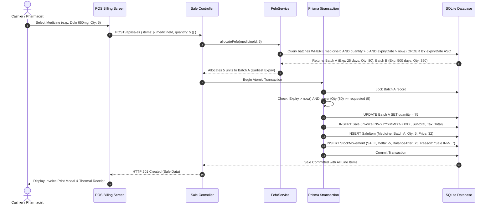

# System Architecture & Technical Specifications
## PharmaCore ERP — Pharmacy Management System

### 1. High-Level Modular Monolith Architecture

The system is constructed as a clean, modular monolith separating the user presentation layer, business rules & transaction management layer, and database persistence layer.

```
┌────────────────────────────────────────────────────────────────────────┐
│                        CLIENT LAYER (React 18 + Vite)                  │
│                                                                        │
│  ┌──────────────┐  ┌──────────────┐  ┌──────────────┐  ┌────────────┐  │
│  │ Dashboard    │  │ POS Billing  │  │ Inventory    │  │ Reports    │  │
│  │ (KPIs/Alerts)│  │ (FEFO/Cart)  │  │ (Batches)    │  │ (Reconcile)│  │
│  └──────┬───────┘  └──────┬───────┘  └──────┬───────┘  └─────┬──────┘  │
│         └─────────────────┴────────┬────────┴────────────────┘         │
│                                    ▼                                   │
│                 Axios Client + JWT Bearer Interceptors                 │
└────────────────────────────────────┬───────────────────────────────────┘
                                     │ HTTP / REST API (Port 5001)
                                     ▼
┌────────────────────────────────────────────────────────────────────────┐
│                        API & BUSINESS LOGIC LAYER                      │
│                           (Express + TypeScript)                       │
│                                                                        │
│  [Auth Middleware (JWT Verify)] ──► [Server-side RBAC (Role Enforce)]  │
│                                  │                                     │
│  ┌───────────────────────────────┴──────────────────────────────┐      │
│  ▼                                                              ▼      │
│  Controllers (Auth, Medicine, Sale, Batch, Return, Report)             │
│  │                                                                     │
│  ▼                                                                     │
│  Services (FefoService, SaleService, InventoryService, ReportService)  │
│  • FEFO Batch Sorting & Stock Allocation Algorithm                     │
│  • Expired Batch Safety Validator (Blocks Sales where Expiry <= Today) │
│  • Negative Stock Invariant Guard (Rejects deltas where stock < 0)     │
│  • Mandatory Reason Validator for Returns & Adjustments                │
│  • Double-entry Stock Movement Ledger Writer                           │
└────────────────────────────────────┬───────────────────────────────────┘
                                     │ Prisma Client (ACID Transactions)
                                     ▼
┌────────────────────────────────────────────────────────────────────────┐
│                         PERSISTENCE LAYER (SQLite)                     │
│                                                                        │
│  • SQLite Single-File Engine (pharmacy.db) with WAL Journal Mode       │
│  • ACID Compliant Transactions via `prisma.$transaction()`             │
│  • Granular Batch Tables with Composite Unique & Expiry Indexes        │
│  • Complete Stock Movement Audit Ledger Table                          │
└────────────────────────────────────────────────────────────────────────┘
```

---

### 2. FEFO (First-Expiry-First-Out) Dispensing Flow

When a cashier or pharmacist enters a sale at the Point of Sale (POS), the system guarantees that medication is dispensed strictly from the earliest-expiring active batch:



---

### 3. Concurrency, Race Condition & Negative Stock Protection

#### Problem:
In high-throughput pharmacies, two cashiers at different terminals might attempt to sell the last 10 units of an antibiotic simultaneously. A naive implementation without transaction isolation would allow both sales to proceed, causing stock to silently drop to $-10$.

#### Solution Implemented:
1. **Prisma `$transaction` Wrapper**: All stock deductions (sales, breakage disposals, audit write-offs) are executed inside an atomic database transaction.
2. **Pre-check inside Transaction**: Within the transaction boundary, the current batch row is freshly queried:
   ```typescript
   const currentBatch = await tx.batch.findUnique({ where: { id: batchId } });
   if (currentBatch.quantity < deductionQuantity) {
     throw new Error(`Insufficient stock for batch ${currentBatch.batchNumber}. Available: ${currentBatch.quantity}, Required: ${deductionQuantity}`);
   }
   ```
3. **Application Invariant Guard**:
   If `currentBatch.quantity - deductionQuantity < 0`, the transaction is immediately aborted and rolled back. SQLite rolls back the dirty write, ensuring stock **never silently or explicitly becomes negative**.

---

### 4. Role-Based Access Control (RBAC) Matrix

| Endpoint / Action | Minimum Required Role | ADMIN | PHARMACIST | CASHIER |
|:---|:---|:---:|:---:|:---:|
| User Login (`/api/auth/login`) | Any Active Staff | ✅ | ✅ | ✅ |
| Current Profile (`/api/auth/me`) | Any Active Staff | ✅ | ✅ | ✅ |
| Create User Account (`/api/auth/register`) | `ADMIN` | ✅ | ❌ | ❌ |
| Browse Medicines & Batches (`/api/medicines`, `/api/batches`) | Any Active Staff | ✅ | ✅ | ✅ |
| Add/Edit Medicine Catalogue | `ADMIN`, `PHARMACIST` | ✅ | ✅ | ❌ |
| Create Batch Manually (`/api/batches`) | `ADMIN`, `PHARMACIST` | ✅ | ✅ | ❌ |
| Create Point-of-Sale Sale (`/api/sales`) | `ADMIN`, `PHARMACIST`, `CASHIER` | ✅ | ✅ | ✅ |
| View & Reprint Invoices (`/api/sales/:id`) | `ADMIN`, `PHARMACIST`, `CASHIER` | ✅ | ✅ | ✅ |
| Ingest Supplier Purchase Orders (`/api/purchases`) | `ADMIN`, `PHARMACIST` | ✅ | ✅ | ❌ |
| Record Returns & Adjustments (`/api/returns/adjust`) | `ADMIN`, `PHARMACIST` | ✅ | ✅ | ❌ |
| View Stock Movement Audit Ledger (`/api/audit`) | `ADMIN`, `PHARMACIST` | ✅ | ✅ | ❌ |
| View Inventory Reconciliation Report (`/api/reports/reconciliation`) | `ADMIN`, `PHARMACIST` | ✅ | ✅ | ❌ |
| View Financial Valuation Report (`/api/reports/valuation`) | `ADMIN`, `PHARMACIST` | ✅ | ✅ | ❌ |
| Manage Suppliers (`/api/suppliers`) | `ADMIN`, `PHARMACIST` | ✅ | ✅ | ❌ |

---

### 5. API Documentation & OpenAPI Specification

The backend serves an interactive OpenAPI 3.0 / Swagger UI documentation explorer directly at:
```
http://localhost:5001/api-docs
```
Reviewers can test each API endpoint interactively using the pre-seeded JWT tokens.
