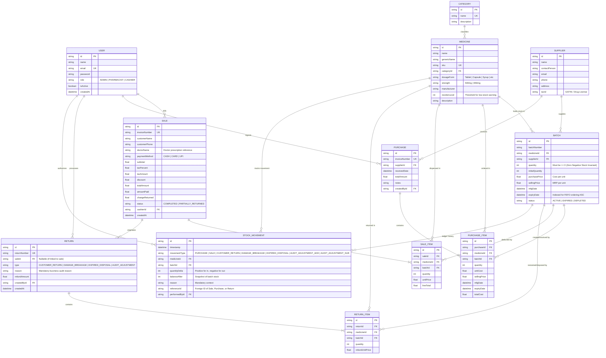

# Entity Relationship Diagram (ERD) & Database Schema
## Pharmacy Management System (PharmaCore ERP)

### 1. Conceptual & Relational Data Model (Mermaid ERD)

---

### 2. Relational Schema Integrity & Constraint Design

| Table Name | Primary Key | Foreign Keys | Unique Constraints | Indexes | Invariant Enforced |
|:---|:---|:---|:---|:---|:---|
| `User` | `id` (cuid) | None | `email` | `email` | Authenticated staff identity & RBAC role |
| `Category` | `id` (cuid) | None | `name` | `name` | Medical drug classification taxonomy |
| `Supplier` | `id` (cuid) | None | None | `name` | Licensed distributor contact & GSTIN |
| `Medicine` | `id` (cuid) | `categoryId` | `sku` | `[categoryId]`, `[name]` | Pharmaceutical catalogue & reorder thresholds |
| `Batch` | `id` (cuid) | `medicineId`, `supplierId` | `[medicineId, batchNumber]` | `[medicineId]`, `[expiryDate]`, `[batchNumber]` | Granular inventory; `quantity >= 0`; `expiryDate` for FEFO |
| `Purchase` | `id` (cuid) | `supplierId`, `createdById` | `invoiceNumber` | `invoiceNumber` | Supplier stock-in procurement records |
| `PurchaseItem` | `id` (cuid) | `purchaseId`, `medicineId`, `batchId` | None | `[purchaseId]`, `[batchId]` | Ingested batch quantities and unit costs |
| `Sale` | `id` (cuid) | `cashierId` | `invoiceNumber` | `[invoiceNumber]`, `[createdAt]` | Point-of-sale customer receipts & tax collection |
| `SaleItem` | `id` (cuid) | `saleId`, `medicineId`, `batchId` | None | `[saleId]`, `[batchId]` | Specific batch deductions & line pricing |
| `Return` | `id` (cuid) | `saleId`, `createdById` | `returnNumber` | `[returnNumber]`, `[saleId]` | Mandatory audited returns and write-offs |
| `ReturnItem` | `id` (cuid) | `returnId`, `medicineId`, `batchId` | None | `[returnId]`, `[batchId]` | Quantities returned or written off |
| `StockMovement` | `id` (cuid) | `medicineId`, `batchId`, `performedById` | None | `[medicineId]`, `[batchId]`, `[timestamp]`, `[movementType]` | Immutable chronological inventory ledger |

---

### 3. Mathematical Reconciliation Formula

For any medicine $M$ across all its batches $B_1, B_2, \dots, B_n$, the system ensures the closing balance is strictly derived from the audit log:

$$\text{Calculated Stock} = \sum \Delta Q_{\text{PURCHASE}} - \sum |\Delta Q_{\text{SALE}}| + \sum \Delta Q_{\text{RETURN}} + \sum \Delta Q_{\text{AUDIT\_ADD}} - \sum |\Delta Q_{\text{AUDIT\_SUB}}|$$

$$\text{Actual Batch Stock} = \sum_{i=1}^{n} \text{quantity}(B_i)$$

$$\text{Discrepancy} = \text{Calculated Stock} - \text{Actual Batch Stock} \equiv 0$$
